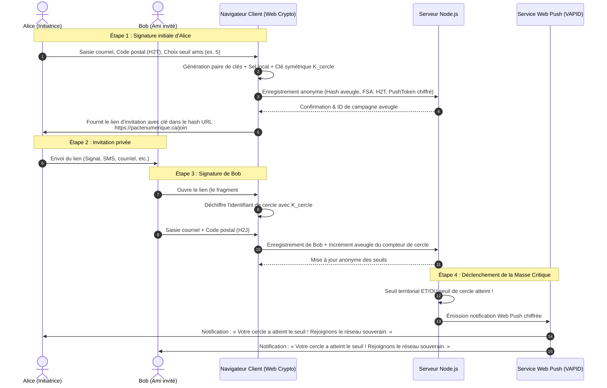

# Conception d'Architecture : PacteNumérique.ca (pactenumerique.ca)

## 1. Vision et Objectifs

### 1.1 Contexte et Problématique
Les plateformes des géants de la « Big Tech » américaine (Meta/Facebook/Instagram, X/Twitter, Google, etc.) maintiennent un monopole sur les interactions sociales en raison d'un effet de réseau massif (*network effect*). 
Même lorsqu'un citoyen canadien souhaite migrer vers des réseaux sociaux et services numériques souverains (le Fédiverse/Mastodon, Bluesky/ATProto, Matrix, hébergements coopératifs ou infonuagiques québécois/canadiens), il se heurte au **dilemme de l'action collective** :
> *« Je partirais bien, mais aucun de mes amis n'y est encore, et mes amis ne partent pas parce que je suis encore sur la plateforme dominante. »*

### 1.2 La Solution : Le Pacte Numérique Conditionnel
**PacteNumérique.ca** est une plateforme d'engagement conditionnel (« assurance contract » numérique) :
1. **Engagement mutuel :** Le citoyen s'engage à rejoindre ou créer un compte sur un réseau souverain **si et seulement si** une masse critique est atteinte dans son cercle d'amis et sur son territoire.
2. **Confidentialité par conception (*Zero-Knowledge* & Chiffrement de bout en bout) :** Les créateurs et serveurs de `pactenumerique.ca` ne doivent **jamais** pouvoir reconstituer le graphe social (qui est ami avec qui) ni détenir une liste en clair des citoyens et de leurs relations.
3. **Ancrage territorial canadien :** Mesure de la masse critique à l'échelle locale (code postal / RTA) et pancanadienne.
4. **Bilinguisme natif :** Français et Anglais intégrés dès la conception.
5. **Déclenchement coordonné :** Une notification fureteur (*Web Push*) avertit les signataires lorsque le pacte est débloqué pour franchir le pas ensemble.

---

## 2. Parcours Utilisateur & Mécanique du Pacte



### 2.1 Les étapes clés
1. **Prise d'engagement :**
   - Sélection de la langue (FR / EN).
   - Code postal (validation du format canadien `A1A 1A1`, tronqué au RTA/FSA `A1A` pour le stockage).
   - Courriel (optionnel si Web Push activé, ou chiffré de bout en bout).
   - Activation facultative des notifications fureteur (*Web Push Notification*).
   - Paramétrage de la condition : « Je bascule si **$N$ amis** me rejoignent » (ex. 3, 5, 10 amis).
2. **Génération du lien d'invitation chiffré :**
   - Le lien contient une clé symétrique dans le fragment d'URL (`#k=...`). **Rappel technique :** Selon la spécification HTTP, le fragment après le `#` n'est **jamais** envoyé au serveur.
3. **Effet boule de neige :**
   - L'ami qui clique dérive la clé du cercle dans son navigateur, valide son propre pacte et peut à son tour étendre le cercle.
4. **Notification de bascule (The Leap) :**
   - Dès que le seuil de l'initiateur est atteint, un push fureteur est envoyé avec un guide de bienvenue vers le réseau souverain recommandé (ou instance décentralisée choisie).

---

## 3. Architecture Cryptographique & Protection du Graphe Social

### 3.1 Objectif « Zero-Knowledge » sur le réseau relationnel
Le risque majeur des plateformes de pétitions ou de parrainage traditionnelles est la création d'un **graphe social centralisé** qui révèle la vie privée des opposants ou des citoyens engagés.

| Donnée | Risque si stocké en clair | Solution PacteNumérique |
| :--- | :--- | :--- |
| **Identité / Courriel** | Fichage, fuites, usurpation | Hachage salé à sens unique (Argon2id/HMAC) pour déduplication + Chiffrement asymétrique (clé serveur publique ou Web Crypto locale). |
| **Graphe social (qui connaît qui)** | Surveillance, cartographie d'influence | **Chiffrement par fragment d'URL + Jetons d'incrément aveugles (Blind Tokens)**. Le serveur ne stocke que des compteurs anonymisés d'objectifs sans pouvoir relier l'arbre généalogique des signataires. |
| **Localisation exacte** | Profilage précis du domicile | Troncation systématique au **RTA (Région de Tri d'Acheminement / FSA)** : ex. `H2T` au lieu de `H2T 2N5`. |
| **Endpoint Web Push** | Lien avec l'adresse IP et navigateur | Stockage des abonnements Push (VAPID) associés à des pseudonymes éphémères révoquables. |

### 3.2 Protocole de parrainage aveugle (*Blind Referral Scheme*)
1. **Création du cercle par Alice :**
   - Le fureteur d'Alice génère une clé symétrique AES-GCM 256 bits $K_{cercle}$.
   - Alice génère un identifiant public de compteur aveugle : $\text{ID}_{blind} = \text{BLAKE3}(K_{cercle} \parallel \text{"public"})$.
   - Alice génère un jeton secret de déverrouillage : $T_{secret} = \text{BLAKE3}(K_{cercle} \parallel \text{"secret"})$.
   - Le serveur enregistre une ligne : `{ blind_id: ID_blind, target_count: 5, current_count: 0, push_sub_encrypted: [...] }`.
   - L'URL d'invitation générée est :  
     `https://pactenumerique.ca/pacte#k=<Base64URL(K_cercle)>`
2. **Adhésion de Bob :**
   - Bob charge l'application. Son fureteur lit `k` dans `window.location.hash`.
   - Son fureteur calcule $\text{ID}_{blind} = \text{BLAKE3}(K_{cercle} \parallel \text{"public"})$.
   - Bob soumet son engagement pour son propre code postal + envoie une requête d'incrément pour $\text{ID}_{blind}$ munie d'une preuve de travail (Proof-of-Work anti-spam).
   - Le serveur incrémente le compteur anonyme associé à $\text{ID}_{blind}$ : `current_count += 1`.
   - **Le serveur ne peut pas savoir qui a créé $\text{ID}_{blind}$, ni qui est Bob, ni si Bob habite la même ville qu'Alice.**

---

## 4. Découpage Territorial & Masse Critique Canadienne

### 4.1 Granularité : Le RTA (FSA - Forward Sortation Area)
Le code postal canadien comprend 6 caractères alphanumériques de format `A1A 1A1` :
- Les 3 premiers caractères définissent la **Région de Tri d'Acheminement (RTA / FSA)**.
- Il existe environ 1 600 RTA au Canada (ex. `G1K` pour Québec intra-muros, `H2T` pour le Mile-End à Montréal, `K1A` pour Ottawa, `V6B` pour Vancouver).
- **Règle de vie privée :** Le site valide le format complet côté client pour s'assurer de sa validité, mais ne transmet et ne stocke **que** les 3 caractères de la RTA au serveur.

### 4.2 Métriques de Masse Critique
La masse critique est calculée à deux niveaux :
1. **Masse critique de Cercle (Micro) :** Fixée par l'utilisateur (ex. 3 à 10 proches).
2. **Masse critique Territoriale (Macro) :**
   - Par RTA (ex. 250 ou 500 résidents par quartier).
   - Par province / territoire (QC, ON, BC, etc.).
   - À l'échelle nationale (pancanadienne).
3. **Tableau de bord public :**
   - Carte interactive ou thermomètre par région montrant la progression sans jamais divulguer d'informations personnelles.

---

## 5. Architecture Technique & Composants

```
pactenumerique.ca/
├── public/
│   ├── index.html            # Application SPA bilingue (FR / EN)
│   ├── css/
│   │   └── style.css         # Design épuré, accessible, dynamique, mode sombre/clair
│   ├── js/
│   │   ├── app.js            # Logique d'interface & i18n
│   │   ├── crypto.js         # Gestion Web Crypto API (AES-GCM, dérivations SHA-256/BLAKE3)
│   │   ├── push.js           # Gestionnaire d'enregistrement Web Push / Service Worker
│   │   └── sw.js             # Service Worker pour notifications fureteur en arrière-plan
│   └── locales/
│       ├── fr.json           # Traductions françaises
│       └── en.json           # Traductions anglaises
├── src/
│   ├── server.js             # Serveur HTTP Node.js (Fastify ou Express moderne)
│   ├── routes/
│   │   ├── pact.js           # API de signature de pacte et incrément de cercle aveugle
│   │   ├── stats.js          # Statistiques territoriales anonymes par RTA
│   │   └── push.js           # Gestion des abonnements push VAPID et déclenchements
│   ├── services/
│   │   ├── db.js             # Couche persistance MySQL (pool de connexions via mysql2/promise)
│   │   ├── cryptoService.js  # Utilitaires cryptographiques et validations anti-rejeu
│   │   └── notifier.js       # Déclencheur des notifications VAPID Web Push
│   └── utils/
│       └── postalCodes.js    # Validation et classification des codes postaux canadiens
├── .env.example              # Variables d'environnement pour connexion MySQL et clés VAPID
├── package.json
└── DESIGN.md
```

### 5.1 Pile Technologique Sélectionnée
- **Frontend :** HTML5 sémantique, CSS moderne vanilla (design système sur-mesure, typographie moderne, tokens HSL, animations subtiles, micro-interactions), JavaScript ES modules natifs.
- **Sécurité Client :** `window.crypto.subtle` (Web Crypto API standard) pour garantir qu'aucune dépendance tierce ne puisse fuiter les clés.
- **Backend :** Node.js 20+ (Express / Fastify) compatible avec l'environnement d'hébergement Node.js de WHC.ca (Web Hosting Canada via cPanel Node.js Selector ou conteneur Cloud/VPS).
- **Base de données :** MySQL 8.0 / MariaDB (hébergée sur WHC.ca) avec le pilote `mysql2/promise` et pool de connexions optimisé.
- **Notifications :** `web-push` (implémentation du protocole standard RFC 8291 / 8292 avec clés VAPID).
- **Anti-Abus :** Défi Proof-of-Work léger (type SHA-256 hashcash dans le navigateur) pour chaque signature, empêchant les fermes de bots de fausser les compteurs territoriaux.

---

## 6. Spécification des APIs & Données

### 6.1 Schéma de la Base de Données MySQL (Anonymisée)

```sql
-- Encodage recommandé : utf8mb4 / utf8mb4_unicode_ci

-- 1. Engagements individuels (sans lien direct avec les cercles)
CREATE TABLE IF NOT EXISTS pact_commitments (
    id VARCHAR(36) PRIMARY KEY,                    -- UUID v4
    fsa VARCHAR(3) NOT NULL,                       -- 3 caractères RTA (ex: 'H2T')
    province VARCHAR(2) NOT NULL,                  -- Dérivé du FSA (ex: 'QC', 'ON')
    email_hash VARCHAR(64) UNIQUE NULL,            -- HMAC-SHA256(email, SERVER_SECRET) pour anti-doublon
    encrypted_email TEXT NULL,                     -- Optionnel, chiffré avec clé publique administrateur
    push_subscription TEXT NULL,                   -- JSON chiffré {endpoint, keys} pour notification fureteur
    created_at DATETIME DEFAULT CURRENT_TIMESTAMP,
    INDEX idx_fsa (fsa),
    INDEX idx_province (province)
) ENGINE=InnoDB DEFAULT CHARSET=utf8mb4 COLLATE=utf8mb4_unicode_ci;

-- 2. Cercles d'invitation aveugles (Blind Circles)
CREATE TABLE IF NOT EXISTS blind_circles (
    blind_id VARCHAR(64) PRIMARY KEY,              -- Hachage public de la clé du cercle
    target_count INT NOT NULL DEFAULT 5,           -- Seuil fixé par l'initiateur (ex: 5)
    current_count INT NOT NULL DEFAULT 1,          -- Nombre actuel d'adhérents
    is_triggered TINYINT(1) NOT NULL DEFAULT 0,    -- 1 si la masse critique a été notifiée
    created_at DATETIME DEFAULT CURRENT_TIMESTAMP,
    updated_at DATETIME DEFAULT CURRENT_TIMESTAMP ON UPDATE CURRENT_TIMESTAMP,
    INDEX idx_triggered (is_triggered)
) ENGINE=InnoDB DEFAULT CHARSET=utf8mb4 COLLATE=utf8mb4_unicode_ci;

-- 3. Liaisons de notification de cercle (sans identité)
CREATE TABLE IF NOT EXISTS circle_push_listeners (
    id VARCHAR(36) PRIMARY KEY,
    blind_id VARCHAR(64) NOT NULL,
    push_subscription TEXT NOT NULL,               -- Endpoint Web Push pour avertir ce membre
    created_at DATETIME DEFAULT CURRENT_TIMESTAMP,
    INDEX idx_blind_id (blind_id),
    CONSTRAINT fk_circle FOREIGN KEY (blind_id) REFERENCES blind_circles(blind_id) ON DELETE CASCADE
) ENGINE=InnoDB DEFAULT CHARSET=utf8mb4 COLLATE=utf8mb4_unicode_ci;

-- 4. Agrégats territoriaux en cache pour performances temps réel
CREATE TABLE IF NOT EXISTS territory_stats (
    fsa VARCHAR(3) PRIMARY KEY,
    signers_count INT NOT NULL DEFAULT 0,
    target_threshold INT NOT NULL DEFAULT 100,
    INDEX idx_count (signers_count)
) ENGINE=InnoDB DEFAULT CHARSET=utf8mb4 COLLATE=utf8mb4_unicode_ci;
```

### 6.2 Points d'accès d'API (Endpoints)

#### `POST /api/pact/commit`
Création d'un engagement individuel et/ou création d'un nouveau cercle aveugle.
- **Payload :**
  ```json
  {
    "fsa": "H2T",
    "email_hash": "<sha256>",
    "encrypted_email": "<base64_opt>",
    "blind_circle_id": "<hash_public_optionnel>",
    "target_count": 5,
    "push_subscription": { ... },
    "pow_nonce": 184920
  }
  ```
- **Réponse :** Status 201, `{ success: true, local_count: 42, fsa: "H2T" }`

#### `POST /api/circle/join`
Rejoindre un cercle existant via un lien d'invitation.
- **Payload :**
  ```json
  {
    "blind_circle_id": "<hash_public>",
    "push_subscription": { ... },
    "pow_nonce": 94821
  }
  ```
- **Réponse :** `{ success: true, current_count: 4, target_count: 5, unlocked: false }`

#### `GET /api/stats/territory`
Obtenir les statistiques d'adhésion pour la carte et les jauges publiques.
- **Réponse :**
  ```json
  {
    "total_national": 12480,
    "provinces": { "QC": 6200, "ON": 4100, "BC": 1200 },
    "fsa_top": [ { "fsa": "H2T", "count": 180, "target": 200 } ]
  }
  ```

---

## 7. Système de Notifications Fureteur (Web Push)

### 7.1 Fonctionnement VAPID
1. Le client demande la permission de notification native du navigateur (`Notification.requestPermission()`).
2. Le Service Worker obtient une souscription auprès du service de push du navigateur (Mozilla, Google FCM, Apple Push Notification).
3. Le payload de notification est émis lorsque :
   - Le cercle de l'utilisateur atteint son seuil : **« Votre cercle de 5 amis est complet ! »**
   - Le RTA atteint son seuil territorial : **« Votre quartier H2T a atteint sa masse critique (250 signataires) ! »**
4. Le clic sur la notification redirige vers :
   - Le guide de bienvenue sur les réseaux souverains (instructions simples pour créer un compte Mastodon/Bluesky/Matrix canadien).
   - Les liens vers les salons ou instances québécoises/canadiennes hébergées localement.

---

## 8. Considérations Légales, Éthiques et Sécurité

1. **Loi 25 (Québec) et LPRPDE/PIPEDA (Canada) :**
   - Par défaut, la conception *Privacy-by-Design* et *Zero-Knowledge* garantit la conformité stricte : aucune collecte de données superflue, aucun traqueur publicitaire, aucun cookie tiers.
   - Les données de contacts sont chiffrées ou hachées irréversiblement.
2. **Résistance aux attaques Sybil (Faux comptes) :**
   - Exigence d'un hachage de courriel unique ou validation par jeton à usage unique.
   - Algorithme de Proof-of-Work (Hashcash) résolu par le navigateur pour chaque signature afin de freiner les inscriptions massives par scripts.
   - Limitation de débit (*Rate limiting*) sur l'IP sans enregistrer l'adresse IP de manière persistante (hachage roulant journalier).
3. **Hébergement et Souveraineté Canadienne (WHC.ca) :**
   - **Infrastructure WHC (Web Hosting Canada) :** Les données résident 100% en sol canadien (centres de données écologiques certifiés à Montréal et Vancouver), assurant une conformité totale avec les lois canadiennes et québécoises sur la protection des données et éliminant tout assujettissement au *Cloud Act* américain.
   - **Configuration cPanel / Node.js Selector ou Cloud WHC :**
     - Port écouté configurable via variable d'environnement `PORT` (indispensable pour Phusion Passenger de cPanel).
     - Paramètres de connexion MySQL via fichier `.env` protégé (en dehors du répertoire web racine `public_html` si applicable).

---

## 9. Plan d'Implémentation & Prochaines Étapes

- [x] **Étape 1 :** Finalisation de l'architecture et validation du `DESIGN.md` (adapté pour WHC.ca & MySQL).
- [ ] **Étape 2 :** Initialisation du projet Node.js (`package.json`, pilotes `mysql2`, scripts de migration SQL, variables d'environnement `.env`).
- [ ] **Étape 3 :** Développement du module cryptographique client (`crypto.js`) avec Web Crypto API (génération de clé, chiffrement d'URL par fragment `#`, calcul du blind hash).
- [ ] **Étape 4 :** Développement de l'interface utilisateur bilingue (FR/EN) : design moderne, épuré, dynamique, jauges de masse critique par code postal (RTA).
- [ ] **Étape 5 :** Intégration du Service Worker et protocole Web Push pour les notifications en temps réel.
- [ ] **Étape 6 :** Script de configuration et instructions de déploiement spécifiques pour WHC.ca (Node.js App Selector, MySQL cPanel).

